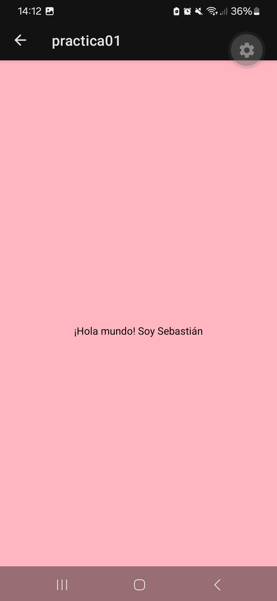
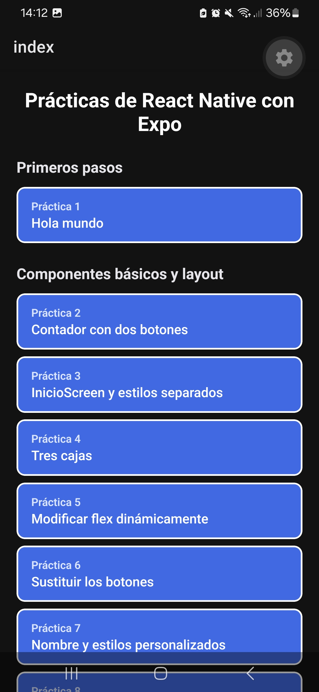
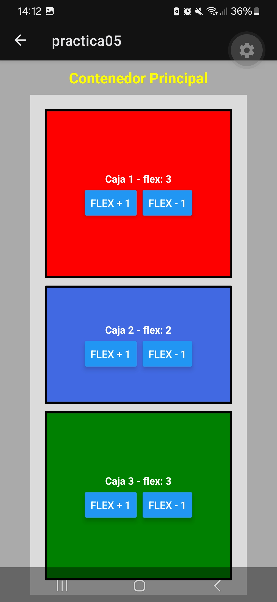
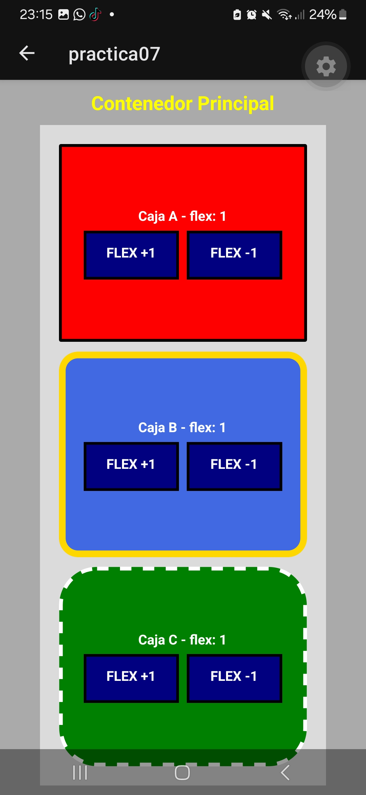
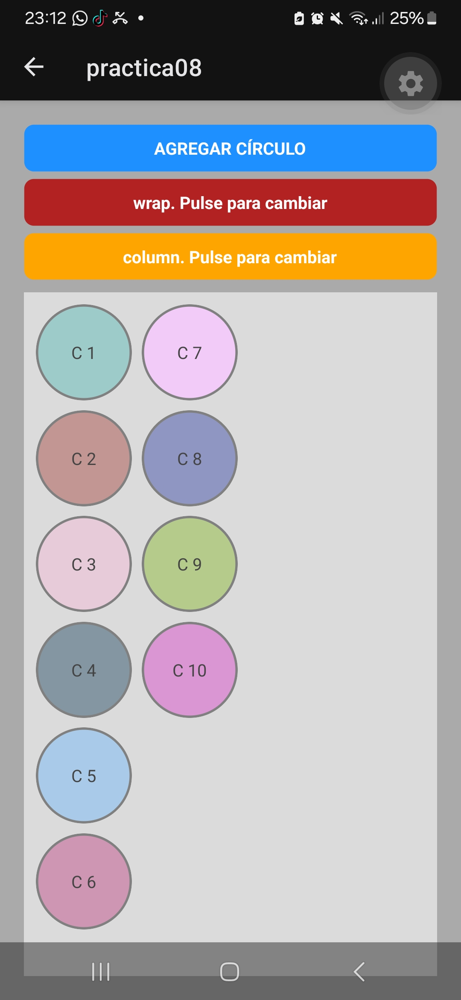
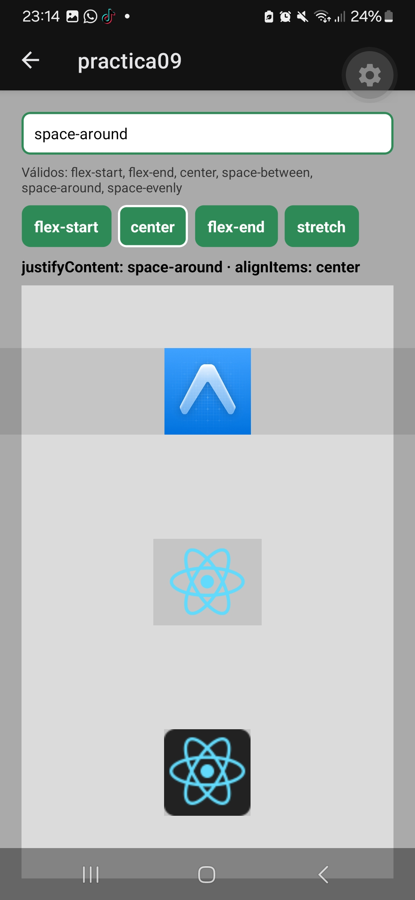

# REACT-NATIVE · Dossier UT2

Proyecto Expo único: `dossier-react-native/`. Todas las prácticas se abren desde el índice (`src/app/index.tsx`).
Cada ruta de `src/app/practicaXX.tsx` reexporta una pantalla de `src/screens/`.

Arranque: `cd dossier-react-native && npx expo start` y pulsar `a` con el emulador abierto.

---

## Práctica 1. Hola mundo

**Procedimiento:** pantalla `src/screens/HolaMundoScreen.tsx` con un `View` y un `Text` que muestra «¡Hola mundo! Soy Sebastián». Estilos con `StyleSheet.create()`: fondo `lightpink`, `flex: 1`, `justifyContent: 'center'` y `alignItems: 'center'`. La ruta `src/app/practica01.tsx` la exporta.

**Captura:**



**Problemas encontrados:** —

**Estado:** ✅ Completada

## Práctica 2. Contador con dos botones

**Procedimiento:** estado `contador` con `useState(0)` y dos `Button`: «Incrementar» (`setContador(n => n + 1)`) y «Decrementar» (`setContador(n => n - 1)`). El valor se muestra en un `Text`. El contenedor personaliza el color de fondo, el color del borde (`borderColor`, `borderWidth`) y redondea las esquinas con `borderRadius`. Ruta: `src/app/practica02.tsx`.

**Captura:**


**Problemas encontrados:** el `Button` nativo no admite estilos de `View`; solo se ha cambiado su `color`.

**Estado:** ✅ Completada

## Práctica 3. `InicioScreen` y estilos separados

**Procedimiento:** el contador de la práctica 2 se ha movido a `src/screens/InicioScreen.tsx`, con sus estilos en `StyleSheet.create()`. El «Hola mundo» se ha conservado en `src/screens/HolaMundoScreen.tsx`. Las rutas de `src/app/` solo enlazan a las pantallas:

```tsx
// src/app/practica03.tsx
export { default } from '../screens/InicioScreen';
```

Como ya se ha creado el índice general (apartado «Estructura de carpetas»), `src/app/index.tsx` es el menú de prácticas en vez de mostrar `<InicioScreen />` directamente.

**Captura:**



**Problemas encontrados:** —

**Estado:** ✅ Completada

## Práctica 4. Tres cajas

**Procedimiento:** componente reutilizable `src/components/Caja.tsx` (100 × 100) que recibe por propiedades `nombre` y `bg` (color de fondo, `green` por defecto) y combina estilos con `style={[styles.caja, { backgroundColor: bg }]}`. La pantalla `src/screens/PrincipalScreen.tsx` muestra el texto «Contenedor Principal» y un `View` escenario con `flex: 1` que contiene tres `Caja` de colores distintos (rojo, azul y verde por defecto). Ruta: `src/app/practica04.tsx`.

**Captura:**


**Problemas encontrados:** —

**Estado:** ✅ Completada

## Práctica 5. Modificar `flex` dinámicamente

**Procedimiento:** nuevo componente `src/components/CajaFlex.tsx`, una variante de `Caja` sin altura fija (con `height: 100` el `flex` apenas se notaría). Recibe por propiedades `nombre`, `bg`, el valor actual `valorFlex` y dos funciones (`onMas` y `onMenos`), y aplica `{ flex: valorFlex }` a su `View`. La pantalla `src/screens/Practica5.tsx` guarda tres estados independientes (`flex1`, `flex2`, `flex3`, empezando en 1) y pasa a cada caja sus funciones: `n => n + 1` para aumentar y `n => Math.max(0, n - 1)` para disminuir sin bajar de 0. Cada caja muestra su valor actual y el escenario reparte el espacio vertical en proporción a esos valores. `Caja` y la práctica 4 no se modifican. Ruta: `src/app/practica05.tsx`.

**Captura:**



**Problemas encontrados:** —

**Estado:** ✅ Completada

## Práctica 6. Sustituir los botones

**Procedimiento:** nuevo componente `src/components/CajaFlexAlert.tsx`, copia de `CajaFlex` en la que los dos `Button` se sustituyen por componentes táctiles personalizados (fondo `navy`, borde negro, ancho fijo y texto en blanco y negrita):

- **`flex + 1`** → `TouchableHighlight` con `underlayColor="#bebebe"`. Al pulsarlo muestra una alerta con `` Alert.alert('Flex', `Creció ${nombre}`) `` y llama a `onMas()`.
- **`flex - 1`** → `TouchableOpacity` con `activeOpacity={0.5}` que llama a `onMenos()`.

La pantalla `src/screens/Practica6.tsx` reutiliza la lógica de la práctica 5 (tres estados independientes y `Math.max(0, n - 1)` para no bajar de 0), pero importa `CajaFlexAlert`. `CajaFlex` y la práctica 5 no se modifican. Ruta: `src/app/practica06.tsx`.

**Captura:**


**Problemas encontrados:** `TouchableHighlight` solo admite un hijo y no muestra el resaltado si no tiene `onPress`.

**Estado:** ✅ Completada

## Práctica 7. Nombre y estilos personalizados

**Procedimiento:** nuevo componente `src/components/CajaEstilo.tsx`, basado en `CajaFlexAlert`, que añade una propiedad opcional `style?: StyleProp<ViewStyle>`. El estilo recibido se combina con el de por defecto en un array:

```tsx
<View style={[styles.caja, { backgroundColor: bg, flex: valorFlex }, style]}>
```

Como `style` va el último, sus propiedades sobrescriben las repetidas de `styles.caja`. La pantalla `src/screens/Practica7.tsx` muestra tres cajas con su nombre:

- **Caja A:** sin `style`, con el aspecto por defecto.
- **Caja B:** esquinas redondeadas (`borderRadius: 20`) y borde dorado más grueso (`borderWidth: 7`).
- **Caja C:** borde blanco discontinuo (`borderStyle: 'dashed'`) y muy redondeado.

Se mantiene la lógica de `flex` de las prácticas 5 y 6. Ruta: `src/app/practica07.tsx`.

**Captura:**



**Problemas encontrados:** el orden del array de estilos importa: si `style` se coloca antes que el estilo por defecto, no sobrescribe nada.

**Estado:** ✅ Completada

## Práctica 8. Círculos dinámicos

**Procedimiento:** nuevo componente reutilizable `src/components/BotonControl.tsx`, un botón personalizado con `TouchableOpacity` (recibe `texto`, `color`, `onPress` y un `activo` opcional que añade un borde blanco). La pantalla `src/screens/Practica8.tsx` guarda tres estados:

- `circulos`: lista de `{ id, color }`, vacía al principio.
- `envolver`: alterna `flexWrap` entre `'wrap'` y `'nowrap'`.
- `enFila`: alterna `flexDirection` entre `'row'` y `'column'`.

«Agregar círculo» añade un elemento con un color calculado a partir de su número; cada canal RGB se limita con `Math.min(255, valor)`. Los círculos se pintan con `map`, usando el `id` como `key` estable, y el texto de los otros dos botones indica el valor activo. Ruta: `src/app/practica08.tsx`.

**Captura:**



**Problemas encontrados:** con `nowrap` los círculos que no caben se salen del escenario en lugar de pasar a la siguiente línea, que es justo el efecto que se quiere observar.

**Estado:** ✅ Completada

## Práctica 9. Distribución, alineación e imágenes

**Procedimiento:** la pantalla `src/screens/Practica9.tsx` contiene:

- Un `TextInput` controlado para escribir el valor de `justifyContent`. Los valores admitidos se definen con un tipo unión (`NonNullable<ViewStyle['justifyContent']>`) y una función `esJustificacion` que actúa como *type guard*. Solo se aplica un valor válido; si no lo es, el borde del campo se pone rojo y se mantiene el último correcto.
- Una fila de `BotonControl` (contenedor anidado con `flexDirection: 'row'`) para elegir `alignItems`: `flex-start`, `center`, `flex-end` o `stretch`. El botón activo se resalta.
- Un texto con la alineación activa (`justifyContent` y `alignItems`).
- Un escenario con `flexWrap: 'nowrap'` y tres imágenes: `icon.png` y `react-logo.png` cargadas con `require` desde `assets/images/`, y una remota con `{ uri: 'https://reactnative.dev/img/tiny_logo.png' }`.

Las imágenes usan `minWidth` en lugar de `width` y `resizeMode: 'contain'` para que el efecto de `stretch` se aprecie. Ruta: `src/app/practica09.tsx`.

**Captura:**



**Problemas encontrados:**

- La ruta de `require` debe ser estática; no se puede construir con una variable.
- Un `string` cualquiera no se puede asignar a `justifyContent` en TypeScript, por eso hace falta el tipo unión y la comprobación.
- Con un `width` fijo en las imágenes, `alignItems: 'stretch'` no tiene efecto visible.

**Estado:** ✅ Completada

---

## Aviso sobre la redacción de este README

Las prácticas las he hecho yo: el código, las decisiones y las pruebas en el emulador. Para ser más eficiente, este README lo ha ido redactando en paralelo un asistente de IA (Claude, mediante Claude Code) a partir de mi código y mis capturas. Después he revisado su contenido para comprobar que describe correctamente lo que hice.

En las prácticas 8 y 9 me quedé atascado y el asistente generó un código de referencia. Lo he estudiado en profundidad y probado en mi dispositivo.
