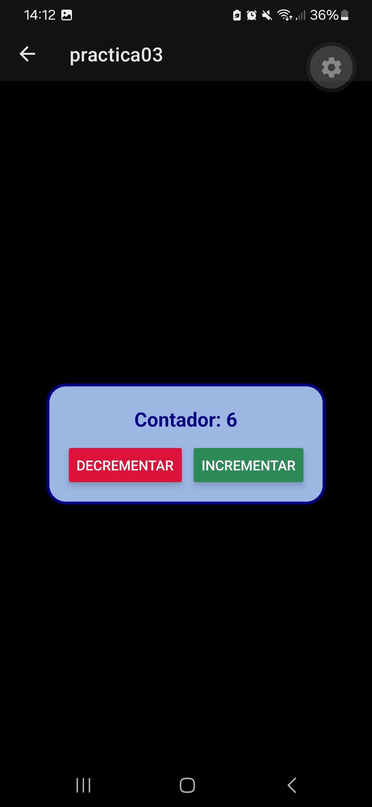
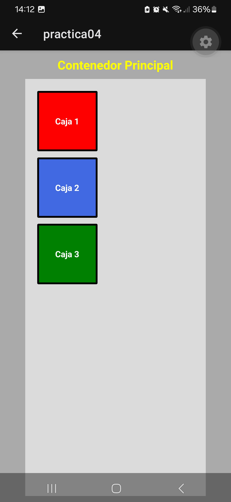
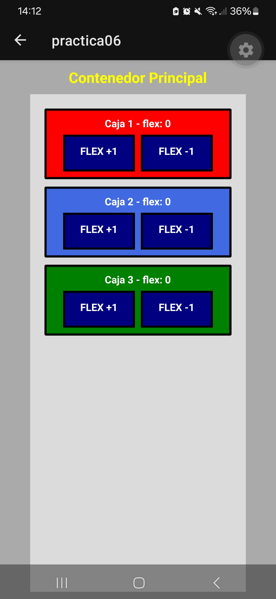

# REACT-NATIVE · Dossier UT2

Proyecto Expo único: `dossier-react-native/`. Todas las prácticas se abren desde el índice (`src/app/index.tsx`).
Cada ruta de `src/app/practicaXX.tsx` reexporta una pantalla de `src/screens/`.

Arranque: `cd dossier-react-native && npx expo start` y pulsar `a` con el emulador abierto.

---

## Práctica 1. Hola mundo

**Procedimiento:** pantalla `src/screens/HolaMundoScreen.tsx` con un `View` y un `Text` que muestra «¡Hola mundo! Soy Sebastián». Estilos con `StyleSheet.create()`: fondo `lightpink`, `flex: 1`, `justifyContent: 'center'` y `alignItems: 'center'`. La ruta `src/app/practica01.tsx` la exporta.

**Captura:**


**Problemas encontrados:** —

**Estado:** ✅ Completada

## Práctica 2. Contador con dos botones

**Procedimiento:** estado `contador` con `useState(0)` y dos `Button`: «Incrementar» (`setContador(n => n + 1)`) y «Decrementar» (`setContador(n => n - 1)`). El valor se muestra en un `Text`. El contenedor personaliza el color de fondo, el color del borde (`borderColor`, `borderWidth`) y redondea las esquinas con `borderRadius`. Ruta: `src/app/practica02.tsx`.

**Captura:**



**Problemas encontrados:** el `Button` nativo no admite estilos de `View`; solo se ha cambiado su `color`.

**Estado:** ✅ Completada

## Práctica 3. `InicioScreen` y estilos separados

**Procedimiento:** el contador de la práctica 2 se ha movido a `src/screens/InicioScreen.tsx`, con sus estilos en `StyleSheet.create()`. El «Hola mundo» se ha conservado en `src/screens/HolaMundoScreen.tsx`. Las rutas de `src/app/` solo enlazan a las pantallas:

```tsx
// src/app/practica03.tsx
export { default } from '../screens/InicioScreen';
```

Como ya se ha creado el índice general (apartado «Estructura de carpetas»), `src/app/index.tsx` es el menú de prácticas en vez de mostrar `<InicioScreen />` directamente.

**Captura:**


**Problemas encontrados:** —

**Estado:** ✅ Completada

## Práctica 4. Tres cajas

**Procedimiento:** componente reutilizable `src/components/Caja.tsx` (100 × 100) que recibe por propiedades `nombre` y `bg` (color de fondo, `green` por defecto) y combina estilos con `style={[styles.caja, { backgroundColor: bg }]}`. La pantalla `src/screens/PrincipalScreen.tsx` muestra el texto «Contenedor Principal» y un `View` escenario con `flex: 1` que contiene tres `Caja` de colores distintos (rojo, azul y verde por defecto). Ruta: `src/app/practica04.tsx`.

**Captura:**



**Problemas encontrados:** —

**Estado:** ✅ Completada

## Práctica 5. Modificar `flex` dinámicamente

**Procedimiento:** nuevo componente `src/components/CajaFlex.tsx`, una variante de `Caja` sin altura fija (con `height: 100` el `flex` apenas se notaría). Recibe por propiedades `nombre`, `bg`, el valor actual `valorFlex` y dos funciones (`onMas` y `onMenos`), y aplica `{ flex: valorFlex }` a su `View`. La pantalla `src/screens/Practica5.tsx` guarda tres estados independientes (`flex1`, `flex2`, `flex3`, empezando en 1) y pasa a cada caja sus funciones: `n => n + 1` para aumentar y `n => Math.max(0, n - 1)` para disminuir sin bajar de 0. Cada caja muestra su valor actual y el escenario reparte el espacio vertical en proporción a esos valores. `Caja` y la práctica 4 no se modifican. Ruta: `src/app/practica05.tsx`.

**Captura:**


**Problemas encontrados:** —

**Estado:** ✅ Completada

## Práctica 6. Sustituir los botones

**Procedimiento:** nuevo componente `src/components/CajaFlexAlert.tsx`, copia de `CajaFlex` en la que los dos `Button` se sustituyen por componentes táctiles personalizados (fondo `navy`, borde negro, ancho fijo y texto en blanco y negrita):

- **`flex + 1`** → `TouchableHighlight` con `underlayColor="#bebebe"`. Al pulsarlo muestra una alerta con `` Alert.alert('Flex', `Creció ${nombre}`) `` y llama a `onMas()`.
- **`flex - 1`** → `TouchableOpacity` con `activeOpacity={0.5}` que llama a `onMenos()`.

La pantalla `src/screens/Practica6.tsx` reutiliza la lógica de la práctica 5 (tres estados independientes y `Math.max(0, n - 1)` para no bajar de 0), pero importa `CajaFlexAlert`. `CajaFlex` y la práctica 5 no se modifican. Ruta: `src/app/practica06.tsx`.

**Captura:**



**Problemas encontrados:** `TouchableHighlight` solo admite un hijo y no muestra el resaltado si no tiene `onPress`.

**Estado:** ✅ Completada

---

## Aviso sobre la redacción de este README

Las prácticas las he hecho yo: el código, las decisiones y las pruebas en el emulador. Para ser más eficiente, este README lo ha ido redactando en paralelo un asistente de IA (Claude, mediante Claude Code) a partir de mi código y mis capturas. Después he revisado su contenido para comprobar que describe correctamente lo que hice.
